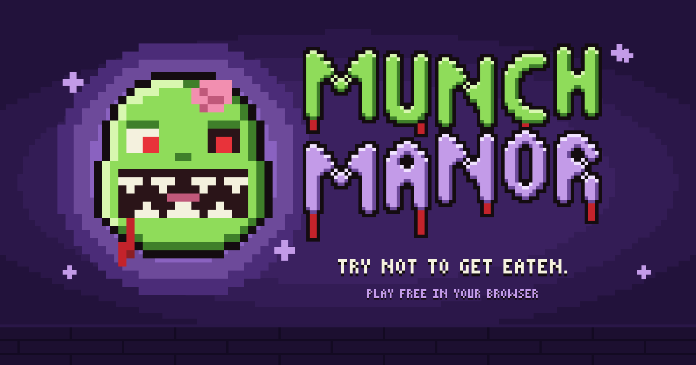
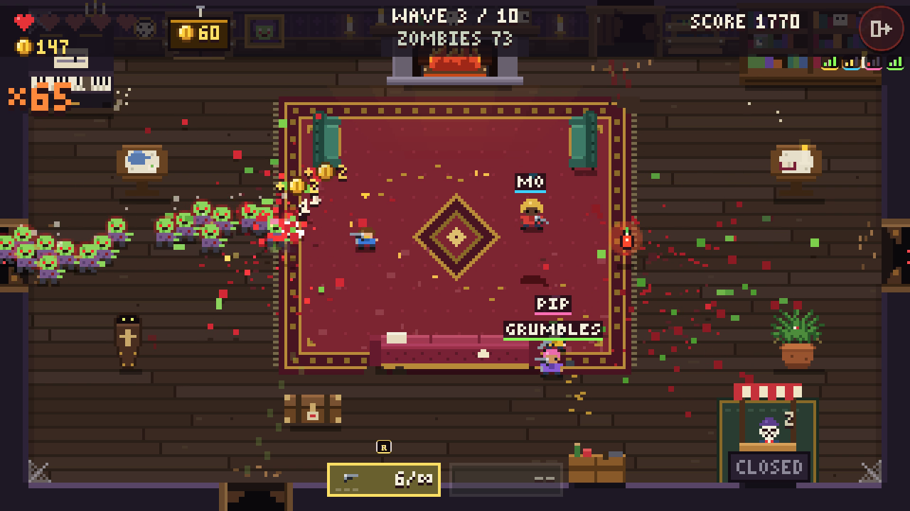

# Munch Manor



**A goofy, gory pixel zombie shooter you can play right now in your browser.** No download, no account, free.

### 🧟 [Play Munch Manor](https://munch-manor.tanner-scadden.workers.dev)

The dead have moved into a creaky old manor, and they're hungry. Hold the parlour, board up the doors, spend your hard-earned cash at Rattles' shop, and survive ten waves of shuffling, sprinting, and exploding zombies, right up to the big boss, Uncle Chunk.



## What's inside

- 🔫 **Ten waves and a boss.** Groaners shuffle, Hotfoots sprint, Kaboomers go boom, and Big Lugs shove everyone aside. Beat Uncle Chunk to win, or keep going in Endless.
- 💀 **Pick your fear.** Easy, Normal, Hard, and, if you dare, Nightmare.
- 🛒 **Rattles' shop.** Upgrade your guns, buy hearts, and set traps like Plank Piles and the Grumpy Gnome.
- 🥡 **Mystery Leftovers.** Open the kitchen and try your luck at the grimy fridge. Maybe a Pressure Cooker, maybe a frying pan, maybe a moldy sandwich.
- 🧑‍🤝‍🧑 **Co-op for up to 4.** Share a room code with friends, or hit QUICK PLAY and we'll find you a crew. Revive each other before you bleed out!
- 🎨 **Dress up.** Hair, beards, glasses, hoodies, dresses, overalls, and a rainbow shirt, on anybody.
- 📖 **The Munchopedia.** Every zombie you meet gets a card.
- 📱 **Plays anywhere.** Keyboard and mouse, or touch on your phone, held sideways or upright. Add it to your Home Screen and it even works offline on a plane.


## How to play

|                             | Keyboard and mouse | Phone                |
| --------------------------- | ------------------ | -------------------- |
| Move                        | WASD               | Left thumb           |
| Aim and shoot               | Mouse, hold click  | Right thumb          |
| Stab                        | F                  | Knife button         |
| Reload / swap guns          | R / Q              | Tap a gun            |
| Place a trap                | T (G picks which)  | Trap button          |
| Buy a door or a fridge pull | Hold Enter         | Hold the hand button |
| Pause                       | Esc                | Pause button         |

The game teaches the rest as you go. Rattles will point you to his shop after your first wave.

## Say hi

Found a bug, have an idea, or just got munched in a funny way? [Open an issue](https://github.com/Tanner-Scadden/munch-manor/issues). Every bit of feedback helps. A lot of what's in the game came from friends playtesting it.

## For the curious

Munch Manor is open source and built with [Foldkit](https://foldkit.dev) and [Effect](https://effect.website), and it runs on Cloudflare. Every game is replayable from its seed, co-op runs the same game on the server, and all the art is drawn in code as tiny pixel maps.

Want to poke around or run it yourself?

```bash
bun install
bun dev
```

The rest lives in a few docs:

- [GAME_DESIGN.md](./GAME_DESIGN.md): the vision, the zombies, the waves, and every decision so far
- [MULTIPLAYER.md](./MULTIPLAYER.md): how co-op works
- [PLATFORM.md](./PLATFORM.md): hosting, saves, and sync
- [AGENTS.md](./AGENTS.md): commands and code rules for contributors

## License

MIT
